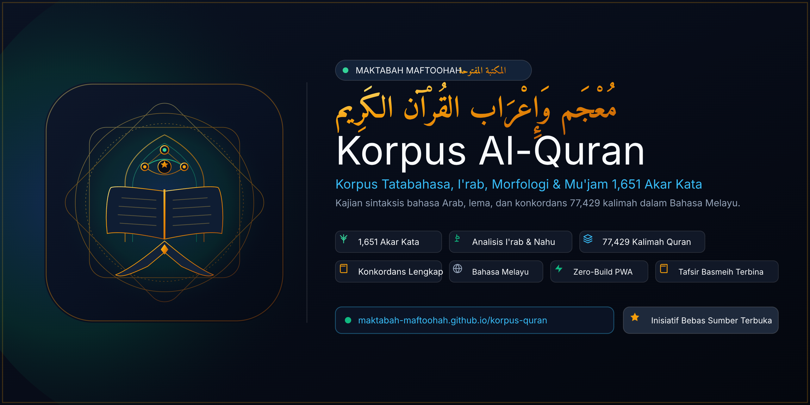

<p align="center">
  
</p>

# Maktabah Maftoohah — Korpus Al-Quran Bahasa Melayu (المكتبة المفتوحة)

[](https://maktabah-maftoohah.github.io/korpus-quran/)
[](LICENSE)
[](manifest.webmanifest)
[](js/app.js)

**Maktabah Maftoohah Korpus Al-Quran** ialah aplikasi korpus linguistik Al-Quran sumber terbuka berasaskan **Bahasa Melayu (Nusantara)** yang pertama seumpamanya. Ia menyediakan analisis sintaksis, tatabahasa Arab (*Ilmu Nahu & Saraf*), pengelasan kata (*Part of Speech*), huraian tanda *I'rab*, serta **Mu'jam 1,651 Akar Kata Lengkap** berserta konkordans seluruh 6,236 ayat Al-Quran.

🌐 **Aplikasi Web Langsung:** [https://maktabah-maftoohah.github.io/korpus-quran/](https://maktabah-maftoohah.github.io/korpus-quran/)

---

## 🌟 Ciri-Ciri Utama (Key Features)

### 1. 🔬 Analisis Morfologi & I'rab Bahasa Melayu
* **Huraian Tatabahasa Jelas**: Mengelaskan setiap kalimah kepada *Kata Nama (Isim)*, *Kata Kerja (Fi'il)*, *Kata Sendi Nama / Partikel (Harf)*, *Kata Ganti Nama (Dhamir)*, *Kata Sifat (Na'at)*, dan partikel lain dengan penerangan terperinci dalam Bahasa Melayu.
* **Penilaian I'rab Automatik**: Menghuraikan keadaan sintaksis (*Marfu', Mansub, Majrur, Majzum, Mabni*) serta tanda baris asal (*Dhammah, Fathah, Kasrah, Sukun*) atau penggantinya.

### 2. 📚 Mu'jam Akar Kata Al-Quran (1,651 Roots)
* **Kamus Akar Kata Lengkap**: Mengindeks seluruh 1,651 akar kata Arab dalam Al-Quran dengan makna terjemahan Bahasa Melayu, statistik kekerapan kemunculan, dan senarai bentuk lema terbitan.
* **Carian Pintar Pantas**: Cari mengikut akar kata Arab (cth: `ر ح م`), ejaan tanpa baris, atau kata kunci terjemahan Bahasa Melayu.

### 3. 📖 Konkordans Ayat Lengkap
* Paparan setiap ayat Al-Quran yang mengandungi akar kata yang dicari dengan teks ayat Uthmani, penyerlahan kalimah sasaran (*highlight*), dan terjemahan rasmi Sheikh Abdullah Muhammad Basmeih.

### 4. 🔗 Keserasian Pautan Pintar (Deep-Linking)
* Pautan terus kalimah mengikut format standard: `#word/{surah}:{ayah}:{kalimah}` (contoh: `#word/1:1:1`).
* Pautan terus akar kata: `#root/{akar_kata}` (contoh: `#root/ر ح م`).
* Pautan dua hala dengan aplikasi [Maktabah Maftoohah Al-Quran](https://maktabah-maftoohah.github.io/al-quran/).

### 5. ⚡ Seni Bina Zero-Build ES6 & PWA
* Dibina sepenuhnya menggunakan vanilla ES6 modules tanpa sebarang bundler atau compiler (Webpack/Vite/Babel).
* PWA sedia digunakan di luar talian (*offline-ready*) dengan sokongan Service Worker.

---

## 🚀 Pengujian & Integriti Projek

```bash
# 1. Sahkan integriti skema dan piawaian fail
python scripts/verify_project.py

# 2. Jalankan ujian browser QA automatik
node scripts/test_qa.js
```

---

## 📜 Hak Cipta & Lesen
Dilesenkan di bawah [Lesen MIT](LICENSE). Maktabah Maftoohah — Inisiatif sumber terbuka untuk manfaat umat Islam sejagat.
